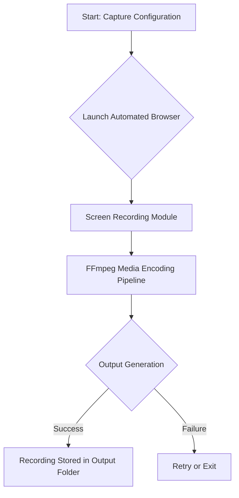

# VisualProof Studio    

## Executive Summary  
**VisualProof Studio** is a lightweight, automated screen-capture toolkit designed to produce high-quality screen recordings and GIFs for demos, tutorials, bug reporting, and documentation. Its customizable capture workflow supports precise control over frame rate, resolution, and duration, making it an indispensable tool for engineers, designers, and project managers.

---

## Key Features  
- 🚀 **Automated Browser Automation**  
   Utilizes headless Chromium instances (via Puppeteer) for fully automated screen recording.  

- 🎥 **High-Quality Output**  
   Supports GIF, MP4, and WebM output formats with configurable frame rates, dimensions, and durations.  

- ⚡ **Encoding Pipeline**  
   Efficient media encoding powered by FFmpeg for performance optimization and high-quality post-processing.  

- 🧩 **Fully Testable**  
   Includes Jest-powered end-to-end tests to validate dimensions, durations, playback, and file formats.  

- 🔒 **Privacy-Aware Design**  
   Temporary files are securely managed with automated cleanup processes to prevent leaks of sensitive content.  

- 📦 **CI/CD Integration**  
   Seamlessly integrated with GitHub Actions for continuous testing and deployment.  

---

## Architecture & Workflow  



- **Screen Recording Module** uses headless Chromium to render the desired viewport and captures the screen via Puppeteer.
- **Media Encoding Pipeline** processes raw screen captures into finalized GIF, MP4, or WebM formats using FFmpeg.
- **Output Storage** ensures temporary files are cleaned up post-processing for efficient storage and security.

---

## Tech Stack & Tools Breakdown  

| **Technology**      | **Purpose**                                                                 |
|----------------------|-----------------------------------------------------------------------------|
| **Node.js**          | Core runtime environment driving the application                           |
| **JavaScript (ES6+)**| Primary language for application logic                                     |
| **Lodash**           | Utility library for data manipulation and functional programming           |
| **Puppeteer**        | Headless browser automation for recording and workflow execution           |
| **FFmpeg**           | Media encoding pipeline for automated post-processing                     |
| **Jest**             | Test runner ensuring robust and bug-free implementation                   |
| **Docker**           | Containerized environments for consistent local and CI/CD operation        |
| **GitHub Actions**   | CI/CD platform for automated testing and deployment pipeline               |

---

## Quickstart / Installation  

### Prerequisites  
- **Node.js** version 16.x or higher  
- FFmpeg installed on your system  
- Docker (optional, for containerized workflows)  

### Installation Steps  

Clone the repository:  
```bash
git clone https://github.com/EF361/kind-borg.git
cd kind-borg
```

Install dependencies:  
```bash
npm install
```

Run tests to ensure everything is set up correctly:  
```bash
npm test
```

### Usage  

1. **Basic Screen Capture (Default Settings)**  
   The example below captures a 15-second GIF of the specified URL:  
   ```bash
   node index.js --url "https://example.com" --output ./recordings/sample.gif
   ```

2. **Customizing Frame Rate and Resolution**  
   ```bash
   node index.js --url "https://example.com" --output ./recordings/highres.mp4 --fps 60 --width 1920 --height 1080
   ```

3. **Using Docker**  
   Build the Docker image:  
   ```bash
   docker build -t visualproof-studio .
   ```  
   Run the container for capturing:  
   ```bash
   docker run --rm -v $(pwd)/recordings:/app/recordings visualproof-studio \
     --url "https://example.com" --output ./recordings/demo.gif
   ```

---

## System Requirements  

- **Operating System:** macOS, Linux, Windows  
- **Hardware:** At least 4GB RAM and 2 CPU cores  
- **Disk Space:** Requires ~100MB for dependencies + any generated recordings  
- **Permissions:** Requires access to system/virtual display and temporary storage  

**Note:** VisualProof Studio respects user privacy by ensuring no sensitive screen content is stored permanently. Temporary files are automatically cleaned, but users should avoid exposing private data during recording.

---

## Testing Guide  

The repository includes a comprehensive Jest-based test suite for validating outputs. Here's how to run and understand the tests:  

```bash
npm test
```

### End-to-End Test Coverage  
- **Duration**: Ensures recordings match the specified duration +/- 1 frame.  
- **Resolution**: Confirms output resolutions match user-provided settings (e.g., 1920x1080).  
- **Frame Rate**: Validates frame count corresponds with specified FPS and duration.  
- **File Format & Playback**: Ensures outputs can be played back without encoding errors.  

---

## Contributing  

1. Fork this repository.  
2. Create a feature branch:  
   ```bash
   git checkout -b feature/my-new-feature
   ```  
3. Commit your changes and push:  
   ```bash
   git commit -m "Add my feature"
   git push origin feature/my-new-feature
   ```  
4. Submit a pull request!  

---

## License  
This repository is licensed under the **MIT License**. See [LICENSE](LICENSE) for more information.  

---

## Acknowledgments  
Special thanks to the open-source community and contributors who made the toolchain (Node.js, Puppeteer, FFmpeg) possible.