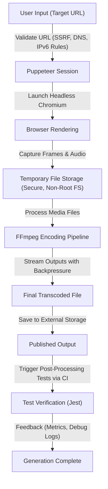

# kind-borg     

## Executive Summary
**kind-borg** automates complex browser workflows using Puppeteer and seamlessly integrates video recording and transcoding with FFmpeg. Designed for precision and reliability, the project provides an efficient toolchain for capturing, processing, and delivering browser-rendered content, with a strong focus on environmental controls, security, and reproducibility.

## Key Features
- 🔒 **SSRF Protection & Security Hardening**: Implements strict URL validation, including support for IPv6, DNS rebinding protection, and redirect validation.
- 🖥️ **Browser Automation**: Utilizes Puppeteer with Chromium to manage headless browser sessions for dynamic content rendering.
- 🎥 **Video Capture & Transcoding**: Reliable integration with FFmpeg for high-quality video encoding while avoiding partial/incomplete outputs via streaming pipelines with backpressure handling.
- 📦 **Dockerized Environment**: Ensures isolation, deterministic builds, and resource constraints for Chromium and FFmpeg with non-root execution and minimal container privileges.
- 📊 **Deterministic Testing**: Comprehensive Jest-based tests validate output codec compatibility, audio sync, frame accuracy, dimensions, and duration consistency.
- 🚀 **Continuous Integration (CI)**: Automated workflows using GitHub Actions for linting, testing, and deployment.
- 🛠️ **Resource Optimization**: Managed large assets and recordings via external storage or release artifacts, reducing committed repository size.
- 🔍 **Debug-Friendly Traceability**: Logs detailed information on browser startup failures, encoding interruptions, and cleanup operations.
- 📓 **Reproducibility**: Thorough documentation of concurrency limits, edge case handling, and platform-specific codec behaviors.

---

## Architecture & Workflow

The following flowchart illustrates the high-level design and operational workflow of **kind-borg**, from input URL validation to video encoding and test verification:



---

## Tech Stack & Tools Breakdown
- **JavaScript ES6+**: Core language for automation and video handling logic.
- **Node.js 18+**: Runtime environment for Puppeteer and FFmpeg integrations.
- **Puppeteer**: Enables seamless headless browser automation with Chromium.
- **Chromium**: Used for rendering dynamic web content prior to video capture.
- **FFmpeg**: Industry-standard media framework for video/audio transcoding and encoding.
- **Jest**: Framework for deterministic test development ensuring quality and compatibility.
- **Docker**: Streamlines deployment with containerized Chromium and FFmpeg environments.
- **GitHub Actions**: Facilitates automated testing, linting, and CI/CD pipelines.
- **Lodash**: Simplifies data manipulation and functional programming utilities.
- **Mermaid Diagrams**: Used for visualizing workflows and system architecture.

---

## Quickstart / Installation

Follow these steps to set up and run **kind-borg** on your local machine:

### Prerequisites
- Node.js v18+ installed
- Docker installed and running
- FFmpeg accessible via the system `$PATH`

### Installation Steps
1. Clone the repository:
   ```bash
   git clone https://github.com/EF361/kind-borg.git
   cd kind-borg
   ```

2. Install dependencies:
   ```bash
   npm install
   ```

3. Build and start the Docker container:
   ```bash
   docker build -t kind-borg .
   docker run --rm -it -v "$(pwd):/app" kind-borg
   ```

4. Run the application:
   ```bash
   npm start -- --url="https://example.com"
   ```

5. Run tests:
   ```bash
   npm test
   ```

### Output Location
Transcoded files and logs will be stored in the `output/` directory by default. Customize this location in the `.env` configuration file.

### Security Notes
Ensure all URLs provided to the tool are explicitly trusted to avoid accidental SSRF risks. Refer to the **Security** section in the documentation for further guidelines.

---

## Contributing
Contributions are welcome! Please open an issue or submit a pull request with detailed descriptions of the changes made.

---

## License
**kind-borg** is licensed under the [MIT License](LICENSE). 

---

**Maintainer**: Alicia Goh (EF361) | **Contact**: [github.com/EF361](https://github.com/EF361)