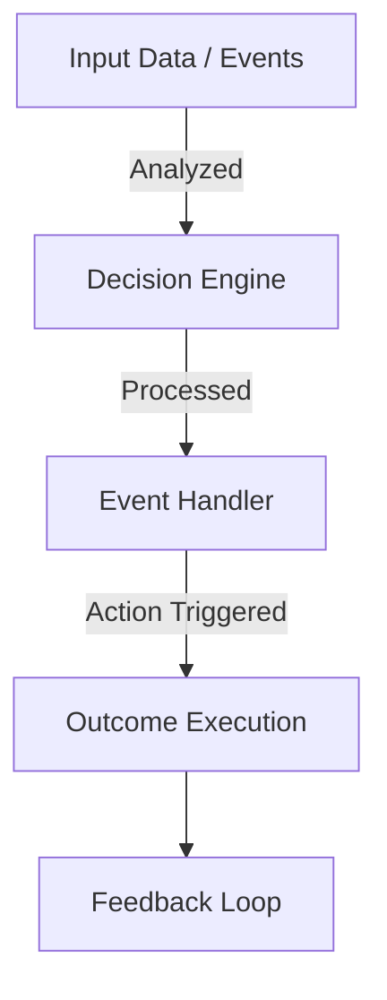

# kind-borg  
  
  
  

> **kind-borg** is an intelligent JavaScript-based framework designed to simulate and automate dynamic, large-scale decision-making processes, empowering developers to build seamless operational workflows for AI-driven systems.

## Key Features  
- **Automated Decision Graphs:** Use dynamic decision-making algorithms for scalable AI-driven workflows.  
- **Extensible Framework:** Provides a modular, plug-and-play architecture for custom integrations.  
- **Event-Driven Design:** High-performance and responsive event-handling to emulate realistic operational logic.  
- **Developer-Friendly API:** Simplifies complex constructs with clean and minimalistic syntax.  

## Architecture & Workflow  



- **Input Data / Events:** User or system-generated inputs trigger workflows.  
- **Decision Engine:** Core logic designed to analyze inputs and create specific pathways.  
- **Event Handler:** Processes actions depending on the decision logic.  
- **Outcome Execution:** Executes results or external action triggers.  
- **Feedback Loop:** Funnels execution results back into the system for iterative processing.  

## Tech Stack & Tools  
- **Language:** JavaScript  
- **Frameworks/Libraries:** Node.js (Event-driven architecture), Lodash (Utility library)  
- **Development Dependencies:** ESLint (Code quality), Jest (Unit testing)  
- **Deployment:** Docker (Containerization), GitHub Actions (CI/CD pipeline)  

## Quickstart / Installation  

Clone the repository to your local system:  

```bash  
git clone https://github.com/EF361/kind-borg.git  
cd kind-borg  
```  

Install dependencies:  

```bash  
npm install  
```  

Run the application:  

```bash  
npm start  
```  

Run tests:  

```bash  
npm test  
```  

Build the project (if applicable):  

```bash  
npm run build  
```  

---

Developed with precision by **Alicia Goh (EF361)**, showcasing expertise in architecting scalable and intelligent JavaScript solutions.