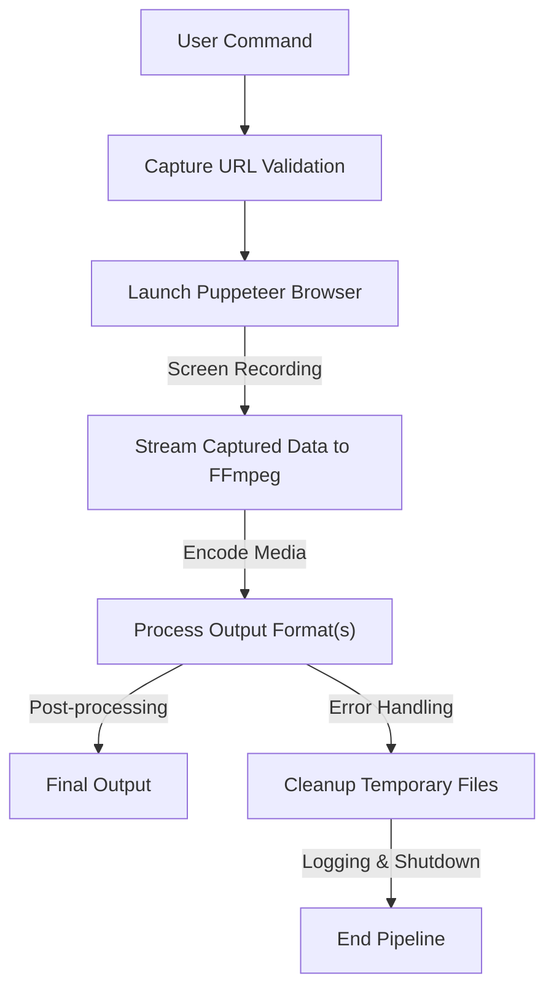

# Kind-Borg 📽️🤖  
  
  
  
  
  
  
  
  

---

## 🚀 Executive Summary

**Kind-Borg** is a modular browser-based screen capture and media encoding pipeline that automates high-fidelity recordings with FFmpeg processing, all while maintaining exceptional cross-platform compatibility and robust privacy guarantees. It abstracts the complexity of capturing browser interactions and encoding into multiple media formats through its clean architecture, containerization, extensive tests, and seamless CI/CD integration.

---

## ✨ Key Features  
- **Headless Browser Automation**: Leverages Puppeteer to capture browser interactions with precision.  
- **Media Encoding Pipeline**: Integrates with FFmpeg for high-performance media processing and output in multiple formats (MP4, WebM, etc.).  
- **Zero-footprint Cleanup**: Ensures proper handling and cleanup of temporary files or interrupted processes.  
- **Error-resilient Operations**: Tests for edge cases like codec unavailability, interrupted encoding, or browser initialization failures.  
- **Secure URL Validation**: Restricts dangerous protocols while safeguarding against accidental internal network exposure.  
- **Platform-agnostic Deployment**: Containerized via Docker for consistent performance across environments.  
- **Pulled Assets**: Large artifacts like Chromium binaries and media samples are managed as external assets or releases.  
- **Strict Dependency Pinning**: Guarantees compatibility with pinned Node.js (18+ LTS) and FFmpeg versions.  
- **Seamless CI/CD Workflows**: GitHub Actions handle build, test, and deployment automation.  

---

## 🛠️ Architecture & Workflow  


---

## 🧰 Tech Stack & Tools  
- **Programming Language**: JavaScript (ES6+)  
- **Runtime**: Node.js (v18+ recommended)  
- **Browser Automation**: Puppeteer (Headless Chromium)  
- **Media Encoding**: FFmpeg (version pinned for stability and codec support)  
- **Utilities**: Lodash (functional programming helpers)  
- **Testing**: Jest (unit and integration tests with edge-case coverage)  
- **Containerization**: Docker (cross-platform portability)  
- **CI/CD**: GitHub Actions  

---

## ⚡ Quickstart / Installation  

1. **Clone the repository**  
   ```bash
   git clone https://github.com/EF361/kind-borg.git
   cd kind-borg
   ```  

2. **Install dependencies**  
   Make sure you have Node.js (v18+) and npm installed.  
   ```bash
   npm install
   ```  

3. **Install FFmpeg**  
   Follow [FFmpeg installation instructions](https://ffmpeg.org/download.html) or use your package manager:  
   ```bash
   # Debian/Ubuntu
   sudo apt update && sudo apt install -y ffmpeg

   # macOS (with Homebrew)
   brew install ffmpeg
   ```  

4. **Run Tests**  
   Verify the pipeline integrity with automated tests:  
   ```bash
   npm test
   ```  

5. **Usage Example**  
   Capture a URL and process video output:  
   ```bash
   node index.js --url https://example.com --output output.mp4
   ```  

6. **Docker Setup**  
   Build and run using Docker for isolated environments:  
   ```bash
   docker build -t kind-borg .
   docker run --rm -v "$(pwd):/app/output" kind-borg --url https://example.com --output /app/output/output.mp4
   ```  

---

## 📚 Documentation  

- **Supported Codecs**: MP4 (H.264), WebM (VP8/VP9), and more.  
- **Platform Dependencies**:  
  - Node.js: v18+ (pinned to prevent compatibility issues).  
  - FFmpeg: Recommended version 4.4+ with support for required codecs.  
- **Performance Metrics**: Benchmarked handling ~25 FPS 1080p captures across modern systems.  
- **Privacy Guarantees**:  
  - No external network calls or telemetry.  
  - Restricted protocols to prevent misuse of private infrastructure.  

For full documentation, see the [Wiki](https://github.com/EF361/kind-borg/wiki).  

---

## 🧑‍💻 About the Author  

**Alicia Goh** (EF361) is a seasoned AI & Software Engineer with a strong focus on developer experience, secure architectures, and scalable platforms. Her work showcases a commitment to clean engineering, rigorous testing, and high-performance solutions.  

---